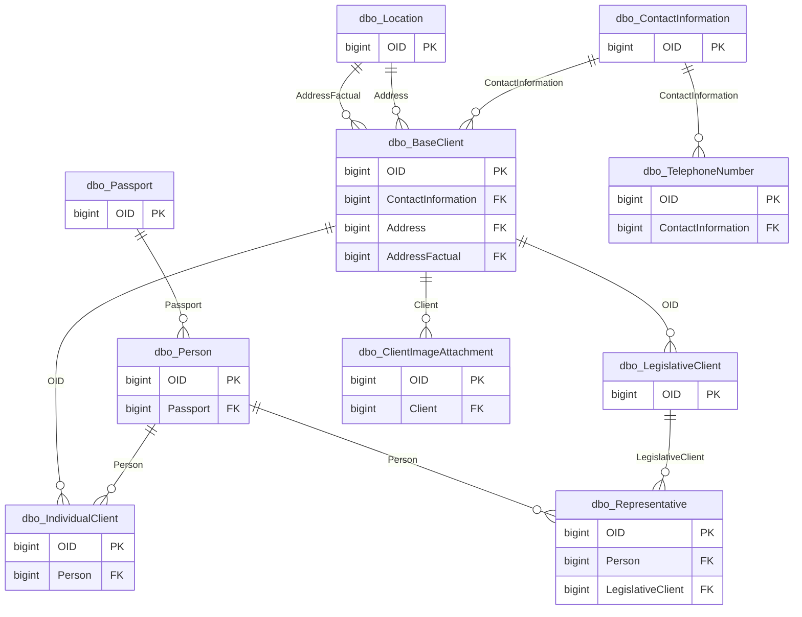
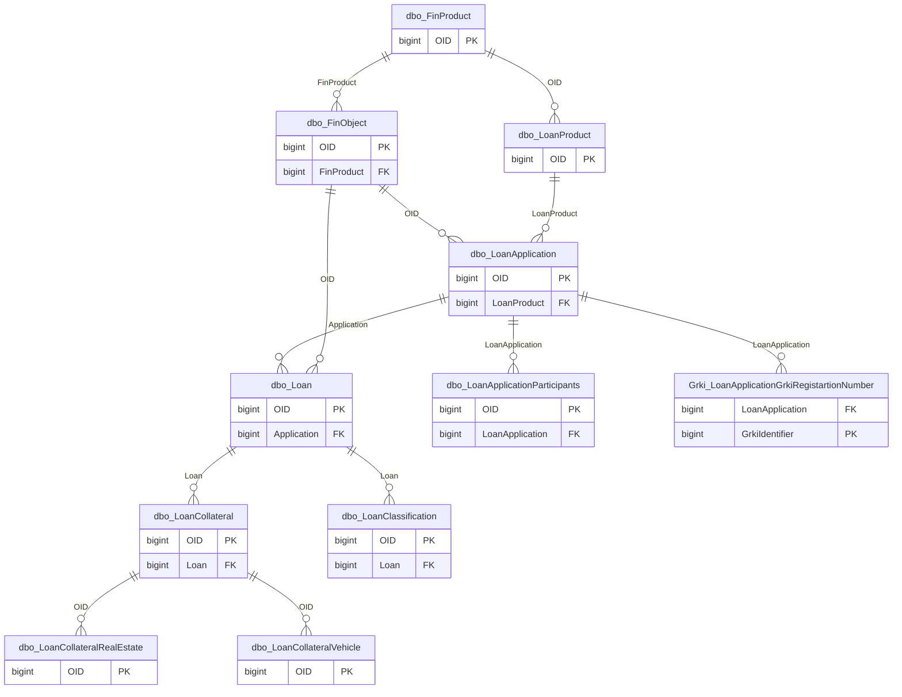
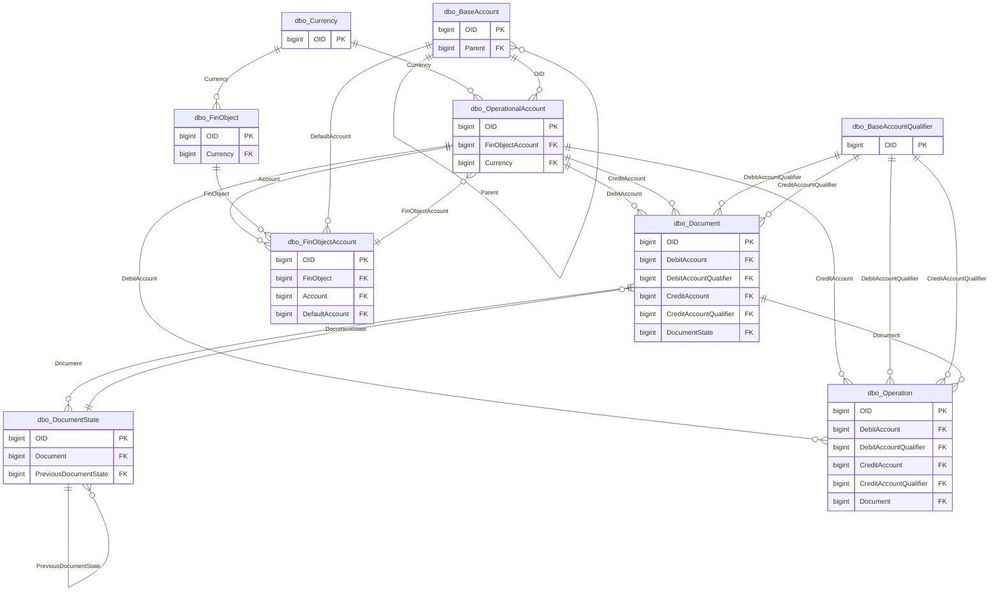
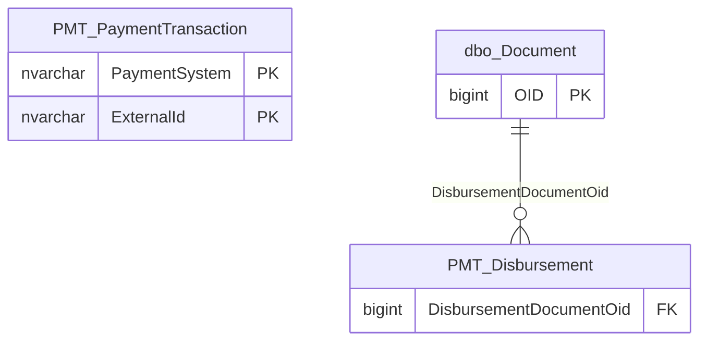

# FlexFin ma'lumotlar modeli

> Avtomatik hosil qilingan (`node scripts/build-docs.mjs`), manba: `schema-dump.txt` (sys.* metama'lumoti). Ma'lumotning o'zi yo'q.

## Umumiy

- **288** jadval (+ 84 ta `cdc.*` tizim jadvali), **2829** ustun, **476** foreign key, **462 900 245** qator.
- Primary key'siz jadval: **27** ta (servis ularni `/v1/raw/<schema.jadval>` orqali o'qiydi).
- **DevExpress XPO**: `OID` (bigint PK), `GCRecord` (soft-delete: `GCRecord IS NOT NULL` = o'chirilgan; filtr `?GCRecord__isnull=true`), `OptimisticLockField` (har yangilanishda oshadi).
- **Merosxo'rlik (class table inheritance):** `Loan.OID → FinObject.OID`, `LoanApplication.OID → FinObject.OID`, `IndividualClient.OID → BaseClient.OID`: bitta obyekt bir nechta jadvalda bitta `OID` bilan yashaydi. `/v1/Loan/{id}/full` zanjirni o'zi yig'adi.

| Schema | Jadval | Qator |
|---|--:|--:|
| dbo | 217 | 462 406 522 |
| ReportGenerator | 9 | 98 |
| DCR | 8 | 114 |
| FlexFinApi | 8 | 283 498 |
| CBReport | 6 | 87 959 |
| PMT | 6 | 73 938 |
| Report | 6 | 24 |
| CdcCore | 5 | 14 033 |
| Grki | 5 | 12 878 |
| Affiliation | 4 | 21 |
| LegalizationUpdater | 4 | 347 |
| CLRUtil | 2 | 175 |
| CloseOperDay | 2 | 20 241 |
| DebtCollector | 2 | 304 |
| Legalisation | 2 | 43 |
| CollateralRegistry | 1 | 43 |
| Crif | 1 | 7 |

## Asosiy sohalar (ER)

### Mijoz

### Kredit

### Buxgalteriya

### To'lov

## Eng ko'p ishora qilinadigan jadvallar

| Jadval | Nechta FK ishora qiladi | Qator |
|---|--:|--:|
| dbo.XPDeletedObject | 132 | 4 444 |
| dbo.BaseClient | 22 | 19 216 |
| dbo.BaseAccountQualifier | 18 | 37 287 |
| dbo.OperationFormula | 14 | 126 |
| dbo.FinProduct | 12 | 21 |
| dbo.FinObject | 12 | 37 251 |
| dbo.OperationalAccount | 10 | 507 446 |
| dbo.LoanCollateral | 10 | 18 613 |
| dbo.FinObjectType | 9 | 12 |
| dbo.XPObjectType | 9 | 137 |
| dbo.FinObjectTypeAccount | 7 | 129 |
| dbo.Country | 7 | 251 |
| dbo.isUser | 7 | 142 |
| dbo.Currency | 6 | 212 |
| dbo.Branch | 6 | 14 |
| dbo.Region | 6 | 14 |
| dbo.District | 6 | 230 |
| dbo.BaseAccount | 6 | 508 134 |
| dbo.ClientTypeClassifier | 5 | 14 |
| dbo.Person | 4 | 19 185 |
| dbo.LoanApplication | 4 | 21 398 |
| dbo.Document | 4 | 5 803 203 |
| dbo.ContactInformation | 4 | 19 325 |
| dbo.FinObjectTypeDocumentTemplate | 4 | 177 |
| dbo.LegislativeClient | 3 | 33 |

## Jadval katalogi

### Affiliation

| Jadval | Qator | Ustun | PK | Ota jadvallar (FK) |
|---|--:|--:|---|---|
| Relation | 0 | 11 | OID | RelationTypeOID→Affiliation.RelationType, InfluentialClient→BaseClient, DependentClient→BaseClient, GCRecord→XPDeletedObject, CreatedBy→isUser |
| RelationGroupType | 2 | 9 | OID | GCRecord→XPDeletedObject |
| RelationHistory | 0 | 14 | OID | RelationTypeOID→Affiliation.RelationType, DependentClient→BaseClient, InfluentialClient→BaseClient, GCRecord→XPDeletedObject, CreatedBy→isUser, MovedToHistoryBy→isUser |
| RelationType | 19 | 10 | OID | RelationGroupTypeOID→Affiliation.RelationGroupType, GCRecord→XPDeletedObject |

### CBReport

| Jadval | Qator | Ustun | PK | Ota jadvallar (FK) |
|---|--:|--:|---|---|
| ChartOfAccounts | 557 | 6 | - |  |
| FieldValue | 60 | 3 | - |  |
| LoanPortfolio | 0 | 47 | - |  |
| LoanPortfolioLiquidityPrincipalPayment | 85 694 | 4 | - |  |
| LoanStatisticsByType | 204 | 12 | - |  |
| TurnoverAndBalanceSheet | 1 444 | 8 | - |  |

### CLRUtil

| Jadval | Qator | Ustun | PK | Ota jadvallar (FK) |
|---|--:|--:|---|---|
| SubstitutionRule | 172 | 3 | RuleId, KeyString |  |
| SubstitutionRuleType | 3 | 2 | Id |  |

### CdcCore

| Jadval | Qator | Ustun | PK | Ota jadvallar (FK) |
|---|--:|--:|---|---|
| ChangedEntity | 14 014 | 19 | - |  |
| Configuration | 1 | 1 | - |  |
| HealthCheck | 1 | 1 | LastCheckTime |  |
| Projects | 16 | 2 | ProjectName |  |
| Session | 1 | 4 | - |  |

### CloseOperDay

| Jadval | Qator | Ustun | PK | Ota jadvallar (FK) |
|---|--:|--:|---|---|
| ExecutionProcessState | 1 | 8 | OID | InitiatedUser→isUser |
| ExecutionProcessStateLog | 20 240 | 12 | OID |  |

### CollateralRegistry

| Jadval | Qator | Ustun | PK | Ota jadvallar (FK) |
|---|--:|--:|---|---|
| SchemaVersions | 43 | 3 | Id |  |

### Crif

| Jadval | Qator | Ustun | PK | Ota jadvallar (FK) |
|---|--:|--:|---|---|
| SchemaVersions | 7 | 3 | Id |  |

### DCR

| Jadval | Qator | Ustun | PK | Ota jadvallar (FK) |
|---|--:|--:|---|---|
| AccountCodeMapping | 10 | 4 | Code, Priority |  |
| Channel | 13 | 2 | Id |  |
| FinObjectTypeAccountMapping | 15 | 4 | FinObjectTypeAccountOID, AccountQualifier, IsBalanceAccount |  |
| ReplicationSession | 1 | 3 | Id |  |
| SchemaVersions | 75 | 3 | Id |  |
| TmpChangedEntity | 0 | 2 | EntityType, EntityId |  |
| TmpLoanOperationBatch | 0 | 9 | - |  |
| TmpLoanScheduleBatch | 0 | 7 | - |  |

### DebtCollector

| Jadval | Qator | Ustun | PK | Ota jadvallar (FK) |
|---|--:|--:|---|---|
| ClientBinding | 275 | 2 | ClientPublicId |  |
| SchemaVersions | 29 | 3 | Id |  |

### FlexFinApi

| Jadval | Qator | Ustun | PK | Ota jadvallar (FK) |
|---|--:|--:|---|---|
| AccountCodeMapping | 9 | 4 | Code, Priority |  |
| Channel | 12 | 2 | - |  |
| FinObjectTypeAccountMapping | 15 | 4 | FinObjectTypeAccountOID, AccountQualifier, IsBalanceAccount |  |
| LastExportedDocumentStateOID | 1 | 1 | DocumentStateOID |  |
| LoanApplicationEarlyRejected | 89 | 1 | LoanApplicationPublicId |  |
| LoanCollateralsWithInsertedOffbalanceOperations | 10 123 | 2 | LoanCollateralOid | LoanCollateralOid→LoanCollateral |
| OperationCache | 272 874 | 8 | LoanOID, Date, Account, OperationOID, Amount |  |
| SchemaVersions | 375 | 3 | Id |  |

### Grki

| Jadval | Qator | Ustun | PK | Ota jadvallar (FK) |
|---|--:|--:|---|---|
| FinObjectChangeQueue | 0 | 4 | FinObjectId |  |
| FinObjectTypeAccountMapping | 28 | 5 | FinObjectTypeAccountOID, AccountQualifier, IsBalanceAccount, IsLmb |  |
| InitialOperDay | 1 | 1 | OperDay |  |
| LoanApplicationGrkiRegistartionNumber | 12 500 | 4 | GrkiIdentifier | Client→BaseClient, LoanApplication→LoanApplication |
| SchemaVersions | 349 | 3 | Id |  |

### Legalisation

| Jadval | Qator | Ustun | PK | Ota jadvallar (FK) |
|---|--:|--:|---|---|
| BlackListCheckReport | 38 | 17 | ID | BlackListCheckReportTaskID→Legalisation.BlackListCheckReportTask |
| BlackListCheckReportTask | 5 | 9 | ID |  |

### LegalizationUpdater

| Jadval | Qator | Ustun | PK | Ota jadvallar (FK) |
|---|--:|--:|---|---|
| LetterOption | 327 | 3 | - |  |
| ListCodeReference | 6 | 3 | ListCode |  |
| SchemaVersions | 13 | 3 | Id |  |
| UpdaterFailsHistory | 1 | 6 | MessageId |  |

### PMT

| Jadval | Qator | Ustun | PK | Ota jadvallar (FK) |
|---|--:|--:|---|---|
| CanceledDisbursement | 0 | 9 | - | DisbursementDocumentOid→Document |
| CanceledDisbursementTransaction | 0 | 6 | Id |  |
| Disbursement | 67 | 8 | - | DisbursementTransactionId→PMT.DisbursementTransaction, DisbursementDocumentOid→Document |
| DisbursementTransaction | 67 | 5 | Id |  |
| PaymentTransaction | 73 776 | 8 | PaymentSystem, ExternalId |  |
| SchemaVersions | 28 | 3 | Id |  |

### Report

| Jadval | Qator | Ustun | PK | Ota jadvallar (FK) |
|---|--:|--:|---|---|
| DataSource | 4 | 6 | Id |  |
| FinObjectMetaData | 4 | 3 | - |  |
| ItemType | 2 | 2 | Id |  |
| Package | 2 | 2 | Id |  |
| ReportItem | 8 | 8 | Id | ItemType→Report.ItemType, Parent→Report.ReportItem |
| ReportLayout | 4 | 2 | Id |  |

### ReportGenerator

| Jadval | Qator | Ustun | PK | Ota jadvallar (FK) |
|---|--:|--:|---|---|
| DataSource | 1 | 8 | Id |  |
| FileType | 2 | 3 | Id |  |
| RegistryFile | 8 | 3 | Id | DataSourceId→ReportGenerator.DataSource, FileType→ReportGenerator.FileType, Id→ReportGenerator.RegistryItem |
| RegistryFileContent | 8 | 2 | Id | Id→ReportGenerator.RegistryFile |
| RegistryItem | 11 | 8 | Id | Id→ReportGenerator.RegistryItem |
| ReportBinding | 8 | 4 | PackageId, FileId | FileId→ReportGenerator.RegistryFile, PackageId→ReportGenerator.ReportPackage |
| ReportPackage | 1 | 3 | Id | DataSourceId→ReportGenerator.DataSource |
| SampleData | 1 | 5 | Id | DataSourceId→ReportGenerator.DataSource |
| SchemaVersions | 58 | 3 | Id |  |

### dbo

| Jadval | Qator | Ustun | PK | Ota jadvallar (FK) |
|---|--:|--:|---|---|
| ASOKIClientType | 14 | 15 | OID | GCRecord→XPDeletedObject |
| ASOKICollateralStatus_A13Reference | 3 | 10 | OID | GCRecord→XPDeletedObject |
| ASOKIDepositType | 2 | 13 | OID | GCRecord→XPDeletedObject |
| ASOKIIgnoreList | 0 | 2 | OID |  |
| ASOKILoanApplicationParticipantStatus_A19Reference | 2 | 10 | OID | GCRecord→XPDeletedObject |
| ASOKILoanApplicationParticipantType_A18Reference | 4 | 10 | OID | GCRecord→XPDeletedObject |
| AccountCodeFormula | 2 | 2 | OID | OID→OperationFormula |
| AccountCodeFormulaSettings | 1 | 8 | OID | AccountCodeFormula→AccountCodeFormula, GCRecord→XPDeletedObject |
| AccountLogicalGroup | 0 | 11 | OID | GCRecord→XPDeletedObject |
| AccountNumerator | 0 | 3 | BalanceAccountCode, Client | Client→BaseClient |
| AccountQualifierAsFinObject | 37 251 | 3 | OID | OID→BaseAccountQualifier, FinObject→FinObject |
| AccountQualifierType | 15 | 9 | OID | GCRecord→XPDeletedObject |
| AffiliationType | 5 | 15 | OID | GCRecord→XPDeletedObject |
| ApplicationData | 1 | 11 | OID | ThisCompany→ThisCompany, GCRecord→XPDeletedObject |
| ApplicationEntry | 196 | 8 | ApplicationName, RelativePathName |  |
| BackupDatabaseErrorLog | 40 | 5 | OID | BackupOID→BackupDatabaseLog |
| BackupDatabaseLog | 2 958 | 11 | OID | CreatedUserOID→isUser |
| BackupDatabaseSettings | 1 | 3 | OID |  |
| BalanceAccount | 688 | 6 | OID | OwnerType→FinObjectType, ClientType→ClientType, AccountQualifierType→AccountQualifierType, OID→BaseAccount |
| BalanceAccountBalanceAccounts_AccountLogicalGroupLogicalGroups | 0 | 5 | OID |  |
| BalanceAccountToFinObjectTypeAccountBinding | 919 | 5 | OID | FinObjectTypeAccount→FinObjectTypeAccount, BalanceAccount→BalanceAccount |
| BalanceAccountToLogicalGroupBinding | 0 | 5 | OID | LogicalGroup→AccountLogicalGroup, BalanceAccount→BalanceAccount |
| Bank | 63 | 17 | OID | Country→Country, GCRecord→XPDeletedObject |
| BankBranch | 1 217 | 19 | OID | Region→Region, District→District, GCRecord→XPDeletedObject |
| BaseAccount | 508 134 | 21 | OID | Branch→Branch, GCRecord→XPDeletedObject, ObjectType→XPObjectType, Parent→BaseAccount |
| BaseAccountQualifier | 37 287 | 13 | OID | GCRecord→XPDeletedObject, ObjectType→XPObjectType, AccountQualifierType→AccountQualifierType |
| BaseClient | 19 216 | 41 | OID | TaxOrganisation→TaxOrganisation, NationalEconomySector2→NationalEconomySector2, ClientType→ClientType, Branch→Branch, ContactInformation→ContactInformation, DirectOrgan→DirectOrgan, NationalEconomySector→NationalEconomySector, PropertyType→PropertyType, GCRecord→XPDeletedObject, ObjectType→XPObjectType, Affiliation→AffiliationType, ClientTypeClassifier→ClientTypeClassifier, Address→Location, AddressFactual→Location, Residency→ResidencyType |
| BorrowerType | 44 | 18 | OID | GCRecord→XPDeletedObject, Parent→BorrowerType, ClientTypeClassifier→ClientTypeClassifier |
| Branch | 14 | 17 | OID | GCRecord→XPDeletedObject |
| CBReportTemplate | 1 | 9 | OID | GCRecord→XPDeletedObject |
| CalculationMethodProviderFormula | 3 | 2 | OID | OID→OperationFormula |
| Calendar | 16 437 | 4 | Date |  |
| Cert | 1 | 4 | OID |  |
| ClientBankAccount | 1 | 13 | OID | Client→BaseClient, BankBranch→BankBranch, GCRecord→XPDeletedObject |
| ClientBlackListItem | 7 721 | 15 | OID | GCRecord→XPDeletedObject |
| ClientImageAttachment | 0 | 12 | OID | Client→BaseClient, ImageAttachmentType→ClientImageAttachmentType, GCRecord→XPDeletedObject |
| ClientImageAttachmentType | 0 | 9 | OID | GCRecord→XPDeletedObject |
| ClientLicense | 1 | 20 | OID | Client→BaseClient, GCRecord→XPDeletedObject |
| ClientType | 0 | 10 | OID | GCRecord→XPDeletedObject |
| ClientTypeClassifier | 14 | 18 | OID | GCRecord→XPDeletedObject |
| ClosedIndividualClientPersonalCitizenCode | 29 | 3 | IndividualClientOid |  |
| CollateralRegistryLegislativeClientSmallBusinessType | 6 | 11 | OID | GCRecord→XPDeletedObject |
| ContactInformation | 19 325 | 10 | OID | GCRecord→XPDeletedObject |
| ContractTemplate | 0 | 11 | OID | GCRecord→XPDeletedObject |
| Country | 251 | 18 | OID | Currency→Currency, GCRecord→XPDeletedObject |
| Currency | 212 | 16 | OID | GCRecord→XPDeletedObject |
| CurrencyRate | 0 | 11 | OID | Currency→Currency, GCRecord→XPDeletedObject |
| CustomFinObject | 111 | 2 | OID | OID→FinObject |
| CustomFinProduct | 4 | 2 | OID | OID→FinProduct |
| Deposit | 0 | 4 | OID | OID→FinObject, DepositType→DepositType |
| DepositProduct | 0 | 3 | OID | OID→FinProduct, DepositType→DepositType |
| DepositType | 4 | 15 | OID | GCRecord→XPDeletedObject |
| DirectOrgan | 439 | 15 | OID | GCRecord→XPDeletedObject |
| District | 230 | 16 | OID | Region→Region, GCRecord→XPDeletedObject |
| Document | 5 803 203 | 19 | OID | DebitAccount→OperationalAccount, CreditAccount→OperationalAccount, DebitAccountQualifier→BaseAccountQualifier, CreditAccountQualifier→BaseAccountQualifier, Client→BaseClient, Branch→Branch, Creator→isUser, Template→FinObjectDocumentTemplate, DocumentState→DocumentState |
| DocumentAmountFormula | 26 | 2 | OID | OID→OperationFormula |
| DocumentDateFormula | 8 | 2 | OID | OID→OperationFormula |
| DocumentNumerationFormula | 1 | 2 | OID | OID→OperationFormula |
| DocumentState | 6 518 524 | 10 | OID | Document→Document, DocumentStateCategory→DocumentStateCategory, User→isUser, PreviousDocumentState→DocumentState |
| DocumentStateCategory | 5 | 10 | OID |  |
| DocumentStateChangeAction | 4 | 13 | OID | CurrentStateCategory→DocumentStateCategory, NewStateCategory→DocumentStateCategory |
| EMail | 1 | 10 | OID | ContactInformation→ContactInformation, GCRecord→XPDeletedObject |
| ETLLastProcessedRecordID | 3 | 3 | - |  |
| EducationType | 5 | 9 | OID | GCRecord→XPDeletedObject |
| Employee | 0 | 9 | OID | GCRecord→XPDeletedObject |
| Factoring | 0 | 7 | OID | DirectionType→GrkiFactoringDirectionType, Type→GrkiFactoringType, Seller→BaseClient, RegressType→GrkiFactoringRegressType, ParticipationType→GrkiFactoringParticipationType, DisclosureType→GrkiFactoringDisclosureType, OID→FinObject |
| FactoringInvoice | 0 | 13 | OID | InvoiceRegistry→FactoringInvoiceRegistry, GCRecord→XPDeletedObject |
| FactoringInvoiceRegistry | 0 | 2 | OID | Factoring→Factoring, OID→FinObject |
| FaxNumber | 8 | 10 | OID | ContactInformation→ContactInformation, GCRecord→XPDeletedObject |
| FinObject | 37 251 | 36 | OID | Client→BaseClient, Currency→Currency, Group→GroupClientItem, Branch→Branch, FinProduct→FinProduct, InterestRateFormula→InterestRateFormula, CalculationMethodProviderFormula→OperationFormula, GCRecord→XPDeletedObject, ObjectType→XPObjectType, PaymentType→PaymentType, ClientTypeClassifier→ClientTypeClassifier |
| FinObjectAccount | 1 095 314 | 15 | OID | Account→OperationalAccount, Parent→FinProductAccount, GCRecord→XPDeletedObject, FinObject→FinObject, DefaultAccount→BaseAccount |
| FinObjectAttachment | 0 | 13 | OID | GCRecord→XPDeletedObject |
| FinObjectDocumentTemplate | 1 667 302 | 24 | OID | DebitAccount→OperationalAccount, CreditAccount→OperationalAccount, DebitAccountQualifier→BaseAccountQualifier, CreditAccountQualifier→BaseAccountQualifier, AvailabilityFormula→TemplateAvailabilityFormula, Parent→FinProductDocumentTemplate, GCRecord→XPDeletedObject, FinObject→FinObject |
| FinObjectExtendedProperty | 625 302 | 13 | OID | Parent→FinProductExtendedProperty, GCRecord→XPDeletedObject, Owner→FinObject |
| FinObjectNumerator | 0 | 3 | Client, FinObjectType | FinObjectType→FinObjectType, Client→BaseClient |
| FinObjectOperationTemplate | 5 210 077 | 21 | OID | DebitAccount→OperationalAccount, CreditAccount→OperationalAccount, DebitAccountQualifier→BaseAccountQualifier, CreditAccountQualifier→BaseAccountQualifier, Parent→FinProductOperationTemplate, GCRecord→XPDeletedObject, DocumentTemplate→FinObjectDocumentTemplate |
| FinObjectType | 12 | 25 | OID | GCRecord→XPDeletedObject |
| FinObjectTypeAccount | 129 | 18 | OID | FinObjectType→FinObjectType, AccountQualifier→BaseAccountQualifier, GCRecord→XPDeletedObject, AccountQualifierType→AccountQualifierType |
| FinObjectTypeAccountFinObjectTypeAccounts_BalanceAccountBalanceAccounts | 0 | 5 | OID |  |
| FinObjectTypeDocumentTemplate | 177 | 33 | OID | FinObjectType→FinObjectType, DebitAccountQualifier→BaseAccountQualifier, CreditAccountQualifier→BaseAccountQualifier, DebitLogicalAccount→FinObjectTypeAccount, CreditLogicalAccount→FinObjectTypeAccount, DateFormula→DocumentDateFormula, AmountFormula→DocumentAmountFormula, AvailabilityFormula→TemplateAvailabilityFormula, GCRecord→XPDeletedObject |
| FinObjectTypeExtendedProperty | 70 | 17 | OID | Owner→FinObjectType, GCRecord→XPDeletedObject |
| FinObjectTypeLogicalAccountGroup | 17 | 11 | OID | FinObjectType→FinObjectType, GCRecord→XPDeletedObject |
| FinObjectTypeLogicalAccountGroupItem | 28 | 12 | OID | AccountQualifier→BaseAccountQualifier, Account→FinObjectTypeAccount, Group→FinObjectTypeLogicalAccountGroup, GCRecord→XPDeletedObject |
| FinObjectTypeOperationTemplate | 540 | 22 | OID | DebitAccountQualifier→BaseAccountQualifier, CreditAccountQualifier→BaseAccountQualifier, DebitLogicalAccount→FinObjectTypeAccount, CreditLogicalAccount→FinObjectTypeAccount, AmountFormula→OperationAmountFormula, DocumentTemplate→FinObjectTypeDocumentTemplate, GCRecord→XPDeletedObject, DescriptionFormula→OperationDescriptionFormula |
| FinProduct | 21 | 23 | OID | FinObjectType→FinObjectType, CalculationMethodProviderFormula→CalculationMethodProviderFormula, Currency→Currency, Branch→Branch, InterestRateFormula→InterestRateFormula, GCRecord→XPDeletedObject, ObjectType→XPObjectType, PaymentType→PaymentType |
| FinProductAccount | 1 172 | 15 | OID | AccountQualifier→BaseAccountQualifier, DefaultAccountQualifier→BaseAccountQualifier, Parent→FinObjectTypeAccount, FinProduct→FinProduct, GCRecord→XPDeletedObject, Account→BaseAccount, DefaultAccount→BaseAccount |
| FinProductAllowableFinProducts_ClientTypeClassifierAllowableClientTypeClassifiers | 30 | 5 | OID | AllowableFinProducts→FinProduct, AllowableClientTypeClassifiers→ClientTypeClassifier |
| FinProductAllowableFinProducts_ContractTemplateAllowableContractTemplates | 0 | 5 | OID | AllowableContractTemplates→ContractTemplate, AllowableFinProducts→FinProduct |
| FinProductDocumentTemplate | 1 756 | 25 | OID | DateFormula→DocumentDateFormula, AmountFormula→DocumentAmountFormula, FinProduct→FinProduct, Parent→FinObjectTypeDocumentTemplate, AvailabilityFormula→TemplateAvailabilityFormula, GCRecord→XPDeletedObject |
| FinProductExtendedProperty | 647 | 12 | OID | Owner→FinProduct, Parent→FinObjectTypeExtendedProperty, GCRecord→XPDeletedObject |
| FinProductOperationTemplate | 6 663 | 15 | OID | AmountFormula→OperationAmountFormula, Parent→FinObjectTypeOperationTemplate, DocumentTemplate→FinProductDocumentTemplate, GCRecord→XPDeletedObject |
| FinProductPolicy | 20 | 28 | OID | FinProduct→FinProduct, PaymentType→PaymentType |
| GlobalVariable | 3 | 14 | OID | GCRecord→XPDeletedObject |
| GrkiBorrowerActivityType | 4 | 8 | OID | GCRecord→XPDeletedObject |
| GrkiBorrowerIncomeSourceType | 8 | 8 | OID | GCRecord→XPDeletedObject |
| GrkiFactoringDirectionType | 2 | 8 | OID | GCRecord→XPDeletedObject |
| GrkiFactoringDisclosureType | 2 | 8 | OID | GCRecord→XPDeletedObject |
| GrkiFactoringParticipationType | 2 | 8 | OID | GCRecord→XPDeletedObject |
| GrkiFactoringRegressType | 2 | 8 | OID | GCRecord→XPDeletedObject |
| GrkiFactoringType | 2 | 8 | OID | GCRecord→XPDeletedObject |
| GrkiLoanAuthorityType | 5 | 4 | OID | GCRecord→XPDeletedObject |
| GroupClient | 0 | 5 | OID | OID→BaseClient, Cashier→GroupClientItem, Leader→GroupClientItem |
| GroupClientItem | 0 | 11 | OID | Client→BaseClient, GCRecord→XPDeletedObject |
| IndividualClient | 19 180 | 7 | OID | Person→Person, OID→BaseClient, EmploymentType→IndividualClientEmploymentType |
| IndividualClientEmploymentType | 4 | 9 | OID | GCRecord→XPDeletedObject |
| IndividualClientRegistrationDocument | 1 | 18 | OID | IndividualClient→IndividualClient, GCRecord→XPDeletedObject |
| InitialBalance | 0 | 9 | OID | Account→OperationalAccount, AccountQualifier→BaseAccountQualifier, GCRecord→XPDeletedObject |
| InterestRateFormula | 1 | 2 | OID | OID→OperationFormula |
| LegalisationInfo | 534 535 | 7 | - |  |
| LegalisationInfoStaging | 76 | 8 | - |  |
| LegislativeClient | 33 | 19 | OID | OID→BaseClient, SmallBusinessType→CollateralRegistryLegislativeClientSmallBusinessType, LegalForm→LegislativeClientLegalForm, ASOKIClientType→ASOKIClientType, RegistrationPlace→RegistrationPlace |
| LegislativeClientFounder | 0 | 15 | OID | Client→BaseClient, FoundersAgreement→LegislativeClientFoundersAgreement, GCRecord→XPDeletedObject |
| LegislativeClientFoundersAgreement | 0 | 14 | OID | LegislativeClient→LegislativeClient, GCRecord→XPDeletedObject |
| LegislativeClientLegalForm | 24 | 14 | OID | GCRecord→XPDeletedObject |
| Loan | 15 738 | 35 | OID | ObjectOfLeasingTypeToDelete→ObjectOfLeasingType, Application→LoanApplication, PurposeAdditional1→LoanPurposeAdditional1, PurposeAdditional2→LoanPurposeAdditional2, PurposeAdditional3→LoanPurposeAdditional3, NationalEconomySector→NationalEconomySector, OID→FinObject, BorrowerType→BorrowerType, LoanType→LoanType, Purpose→LoanPurpose, GrkiApprovedByAuthorityType→GrkiLoanAuthorityType |
| LoanApplication | 21 398 | 22 | OID | DmsApproveReason→LoanApplicationDmsApproveReason, DmsRejectReason→LoanApplicationDmsRejectReason, RejectReason→LoanApplicationRejectReason, OID→FinObject, LoanProduct→LoanProduct, GrkiBorrowerActivityType→GrkiBorrowerActivityType, GrkiRejectedByAuthorityType→GrkiLoanAuthorityType |
| LoanApplicationDmsApproveReason | 0 | 11 | OID | GCRecord→XPDeletedObject |
| LoanApplicationDmsRejectReason | 1 | 11 | OID | GCRecord→XPDeletedObject |
| LoanApplicationGrkiBorrowerIncome | 0 | 5 | OID | LoanApplication→LoanApplication, GCRecord→XPDeletedObject, GrkiBorrowerIncomeSourceType→GrkiBorrowerIncomeSourceType |
| LoanApplicationParticipants | 0 | 13 | OID | Client→BaseClient, LoanApplication→LoanApplication, ASOKILoanApplicationParticipantType→ASOKILoanApplicationParticipantType_A18Reference, GCRecord→XPDeletedObject |
| LoanApplicationProduct | 1 | 2 | OID | OID→FinProduct |
| LoanApplicationRejectReason | 9 | 14 | OID | GCRecord→XPDeletedObject |
| LoanClassification | 20 117 | 13 | OID | GCRecord→XPDeletedObject, ClassificationType→LoanClassificationType, Loan→Loan |
| LoanClassificationType | 5 | 14 | OID | GCRecord→XPDeletedObject |
| LoanCollateral | 18 613 | 55 | OID | CollateralType→LoanCollateralType, GrkiLocationCountry→Country, IndividualGuarantorToDelete→Person, ObjectOfLeasingType→ObjectOfLeasingType, GuarantorToDelete→BaseClient, GuarantorOrOwner→BaseClient, Currency→Currency, GrkiLocationRegion→Region, RepresentationContractType→RepresentationContractType, GrkiLocationDistrict→District, RepresentationRepresentative→IndividualClient, GCRecord→XPDeletedObject, ObjectType→XPObjectType, Loan→Loan, GuarantorClientTypeClassifierToDelete→ClientTypeClassifier, GuarantorResidencyToDelete→ResidencyType |
| LoanCollateralDeposit | 0 | 7 | OID | OID→LoanCollateral, ASOKIDepositType→ASOKIDepositType, DepositBankBranch→BankBranch |
| LoanCollateralEquipment | 0 | 7 | OID | OID→LoanCollateral |
| LoanCollateralGuarantee | 20 | 8 | OID | OID→LoanCollateral, IndividualGuarantorToDelete→Person, GuarantorBankBranchToDelete→BankBranch, GuarantorDirectOrganToDelete→DirectOrgan, GuarantorASOKIClientTypeToDelete→ASOKIClientType, GuarantorNationalEconomySectorToDelete→NationalEconomySector |
| LoanCollateralInsurancePolicy | 3 338 | 7 | OID | OID→LoanCollateral |
| LoanCollateralJewellery | 84 | 8 | OID | OID→LoanCollateral, PreciousMetalFineness→PreciousMetalFineness |
| LoanCollateralRealEstate | 2 466 | 16 | OID | OID→LoanCollateral, LocationCountry→Country, LocationRegion→Region, LocationDistrict→District |
| LoanCollateralType | 36 | 21 | OID | Parent→LoanCollateralType, GCRecord→XPDeletedObject |
| LoanCollateralVehicle | 12 705 | 13 | OID | OID→LoanCollateral, ProductionCountry→Country, VehicleType→VehicleType |
| LoanProduct | 15 | 12 | OID | OID→FinProduct, BorrowerType→BorrowerType, LoanType→LoanType, Purpose→LoanPurpose |
| LoanPurpose | 319 | 24 | OID | GCRecord→XPDeletedObject, Parent→LoanPurpose |
| LoanPurpose112 | 32 | 12 | OID | GCRecord→XPDeletedObject |
| LoanPurposeAdditional1 | 0 | 9 | OID | GCRecord→XPDeletedObject |
| LoanPurposeAdditional2 | 0 | 9 | OID | GCRecord→XPDeletedObject |
| LoanPurposeAdditional3 | 0 | 9 | OID | GCRecord→XPDeletedObject |
| LoanType | 30 | 27 | OID | GCRecord→XPDeletedObject, Parent→LoanType |
| LoanUpdateLog | 166 030 | 11 | - |  |
| Location | 38 434 | 14 | OID | Country→Country, Region→Region, District→District, GCRecord→XPDeletedObject, Mahalla→Mahalla |
| LogDelete | 0 | 5 | ID |  |
| LogUpdate | 0 | 6 | ID |  |
| Mahalla | 9 070 | 17 | OID | District→District, GCRecord→XPDeletedObject |
| NationalEconomySector | 758 | 15 | OID | GCRecord→XPDeletedObject |
| NationalEconomySector2 | 683 | 27 | OID | GCRecord→XPDeletedObject |
| NumerationFormulaSettings | 1 | 9 | OID | GCRecord→XPDeletedObject |
| Numerator | 9 | 11 | OID | GCRecord→XPDeletedObject |
| NumeratorSettings | 12 | 15 | OID | Numerator→Numerator, GCRecord→XPDeletedObject |
| NumeratorValue | 51 | 3 | KeyDate, NumeratorSettings |  |
| ObjectOfLeasingType | 7 | 18 | OID | GCRecord→XPDeletedObject |
| OperDayChangeLog | 2 741 | 5 | - |  |
| Operation | 11 181 676 | 20 | OID | DebitAccount→OperationalAccount, CreditAccount→OperationalAccount, DebitAccountQualifier→BaseAccountQualifier, CreditAccountQualifier→BaseAccountQualifier, Document→Document, GCRecord→XPDeletedObject, ObjectType→XPObjectType, Template→FinObjectOperationTemplate |
| OperationAmountFormula | 44 | 2 | OID |  |
| OperationClassification | 0 | 5 | OID | OperationClassificationRule→OperationClassificationRule, FinObject→FinObject, Operation→Operation |
| OperationClassificationRule | 11 | 14 | OID | FinObjectType→FinObjectType, CreditLogicalAccountGroup→FinObjectTypeLogicalAccountGroup, DebitLogicalAccountGroup→FinObjectTypeLogicalAccountGroup, FinObjectTypeDocumentTemplate→FinObjectTypeDocumentTemplate, GCRecord→XPDeletedObject |
| OperationDescriptionFormula | 4 | 2 | OID | OID→OperationFormula |
| OperationFormula | 126 | 13 | OID | GCRecord→XPDeletedObject, ObjectType→XPObjectType |
| OperationFormulaCompatibleFormulas_FinObjectTypeDocumentTemplateCompatibleDocumentTemplates | 0 | 5 | OID | CompatibleDocumentTemplates→FinObjectTypeDocumentTemplate, CompatibleFormulas→OperationFormula |
| OperationFormulaCompatibleFormulas_FinObjectTypeOperationTemplateCompatibleOperationTemplates | 0 | 5 | OID | CompatibleOperationTemplates→FinObjectTypeOperationTemplate, CompatibleFormulas→OperationFormula |
| OperationNumerationFormula | 1 | 2 | OID | OID→OperationFormula |
| OperationPrintingFormula | 2 | 2 | - | OID→OperationFormula |
| OperationPrintingItem | 3 | 10 | OID |  |
| OperationPrintingItemCard | 429 | 10 | OID |  |
| OperationalAccount | 507 446 | 11 | OID | Client→BaseClient, Currency→Currency, OID→BaseAccount, FinObjectAccount→FinObjectAccount |
| Passport | 19 188 | 16 | OID | RegistrationCountry→Country, RegistrationRegion→Region, PassportType→PassportType, RegistrationDistrict→District, GCRecord→XPDeletedObject |
| PassportType | 10 | 15 | OID | GCRecord→XPDeletedObject |
| PaymentDocumentType | 0 | 8 | OID | GCRecord→XPDeletedObject |
| PaymentType | 4 | 16 | OID | GCRecord→XPDeletedObject |
| PersistentImage | 0 | 8 | OID | GCRecord→XPDeletedObject |
| Person | 19 185 | 20 | OID | Passport→Passport, Education→EducationType, GCRecord→XPDeletedObject |
| PreciousMetalFineness | 16 | 12 | OID | PreciousMetalType→PreciousMetalType, GCRecord→XPDeletedObject |
| PreciousMetalRate | 16 | 13 | OID | GCRecord→XPDeletedObject, PreciousMetalFineness→PreciousMetalFineness |
| PreciousMetalType | 2 | 11 | OID | GCRecord→XPDeletedObject |
| PrintingObjectFormula | 1 | 2 | OID | OID→OperationFormula |
| PropertyAppraisalReport | 13 | 18 | OID | LoanCollateral→LoanCollateral, GCRecord→XPDeletedObject |
| PropertyInsurancePolicy | 0 | 20 | OID | LoanCollateral→LoanCollateral, GCRecord→XPDeletedObject |
| PropertyType | 54 | 13 | OID | GCRecord→XPDeletedObject |
| Region | 14 | 16 | OID | Country→Country, GCRecord→XPDeletedObject |
| RegistrationPlace | 54 | 9 | OID | GCRecord→XPDeletedObject |
| RepresentationContractType | 3 | 11 | OID | GCRecord→XPDeletedObject |
| RepresentationType | 4 | 9 | OID | GCRecord→XPDeletedObject |
| Representative | 4 | 12 | OID | LegislativeClient→LegislativeClient, Person→Person, RepresentationType→RepresentationType, GCRecord→XPDeletedObject |
| ResidencyType | 2 | 14 | OID | GCRecord→XPDeletedObject |
| ScheduleConfiguration | 3 | 12 | OID | FinObjectType→FinObjectType, GCRecord→XPDeletedObject |
| Share | 4 | 2 | OID | OID→FinObject |
| ShareProduct | 1 | 2 | OID | OID→FinProduct |
| SimpleOperationTemplate | 0 | 14 | OID | GCRecord→XPDeletedObject |
| SystemLog | 28 829 399 | 8 | RecordID |  |
| SystemLogValues | 388 614 546 | 6 | RecordID |  |
| TMP_RequestedPinfl | 287 | 4 | - |  |
| Tag | 7 706 | 16 | OID | tagType→TagType, GCRecord→XPDeletedObject |
| TagType | 11 | 13 | OID | GCRecord→XPDeletedObject |
| TaxOrganisation | 236 | 9 | OID | GCRecord→XPDeletedObject |
| TelephoneNumber | 43 724 | 11 | OID | ContactInformation→ContactInformation, GCRecord→XPDeletedObject |
| TemplateAvailabilityFormula | 34 | 2 | OID | OID→OperationFormula |
| ThisCompany | 1 | 2 | OID | OID→LegislativeClient |
| TurnoverAndBalanceCacheWithQualifier | 10 686 223 | 8 | Account, AccountQualifier, Date, Type |  |
| UserSettings | 158 | 10 | OID | GCRecord→XPDeletedObject |
| VehicleType | 6 | 14 | OID | GCRecord→XPDeletedObject |
| XPDeletedObject | 4 444 | 3 | OID | TargetType→XPObjectType |
| XPObjectType | 137 | 4 | OID |  |
| dtproperties | 28 | 7 | id, property |  |
| isGUIPermission | 5 | 10 | OID | GCRecord→XPDeletedObject |
| isPermissionTemplate | 69 | 8 | OID | TableID→isTableList, GroupID→isUserGroup |
| isTableList | 158 | 10 | OID |  |
| isUser | 142 | 18 | OID | Branch→Branch, Settings→UserSettings, GCRecord→XPDeletedObject, GroupID→isUserGroup |
| isUserGroup | 6 | 10 | OID | GCRecord→XPDeletedObject |
| sd | 3 | 5 | - |  |
| sysdiagrams | 3 | 5 | diagram_id |  |
| systranschemas | 0 | 4 | - |  |
| tblAccounts | 321 | 6 | Account |  |
| tmpApplicationEntry | 97 | 8 | - |  |
| tmpProlongatedLoans | 2 557 | 4 | Loan, OperDay |  |
| tmpSchedule | 0 | 4 | FinObjectOID, TemplateCode, Date |  |
| tmpTable | 111 | 3 | - |  |

## Barcha foreign key'lar (476)

Ko'rsatish

| Bola | Ustun | Ota | Ota ustun |
|---|---|---|---|
| Affiliation.Relation | RelationTypeOID | Affiliation.RelationType | OID |
| Affiliation.Relation | InfluentialClient | dbo.BaseClient | OID |
| Affiliation.Relation | DependentClient | dbo.BaseClient | OID |
| Affiliation.Relation | GCRecord | dbo.XPDeletedObject | OID |
| Affiliation.Relation | CreatedBy | dbo.isUser | OID |
| Affiliation.RelationGroupType | GCRecord | dbo.XPDeletedObject | OID |
| Affiliation.RelationHistory | RelationTypeOID | Affiliation.RelationType | OID |
| Affiliation.RelationHistory | DependentClient | dbo.BaseClient | OID |
| Affiliation.RelationHistory | InfluentialClient | dbo.BaseClient | OID |
| Affiliation.RelationHistory | GCRecord | dbo.XPDeletedObject | OID |
| Affiliation.RelationHistory | CreatedBy | dbo.isUser | OID |
| Affiliation.RelationHistory | MovedToHistoryBy | dbo.isUser | OID |
| Affiliation.RelationType | RelationGroupTypeOID | Affiliation.RelationGroupType | OID |
| Affiliation.RelationType | GCRecord | dbo.XPDeletedObject | OID |
| CloseOperDay.ExecutionProcessState | InitiatedUser | dbo.isUser | OID |
| dbo.AccountCodeFormula | OID | dbo.OperationFormula | OID |
| dbo.AccountCodeFormulaSettings | AccountCodeFormula | dbo.AccountCodeFormula | OID |
| dbo.AccountCodeFormulaSettings | GCRecord | dbo.XPDeletedObject | OID |
| dbo.AccountLogicalGroup | GCRecord | dbo.XPDeletedObject | OID |
| dbo.AccountNumerator | Client | dbo.BaseClient | OID |
| dbo.AccountQualifierAsFinObject | OID | dbo.BaseAccountQualifier | OID |
| dbo.AccountQualifierAsFinObject | FinObject | dbo.FinObject | OID |
| dbo.AccountQualifierType | GCRecord | dbo.XPDeletedObject | OID |
| dbo.AffiliationType | GCRecord | dbo.XPDeletedObject | OID |
| dbo.ApplicationData | ThisCompany | dbo.ThisCompany | OID |
| dbo.ApplicationData | GCRecord | dbo.XPDeletedObject | OID |
| dbo.ASOKIClientType | GCRecord | dbo.XPDeletedObject | OID |
| dbo.ASOKICollateralStatus_A13Reference | GCRecord | dbo.XPDeletedObject | OID |
| dbo.ASOKIDepositType | GCRecord | dbo.XPDeletedObject | OID |
| dbo.ASOKILoanApplicationParticipantStatus_A19Reference | GCRecord | dbo.XPDeletedObject | OID |
| dbo.ASOKILoanApplicationParticipantType_A18Reference | GCRecord | dbo.XPDeletedObject | OID |
| dbo.BackupDatabaseErrorLog | BackupOID | dbo.BackupDatabaseLog | OID |
| dbo.BackupDatabaseLog | CreatedUserOID | dbo.isUser | OID |
| dbo.BalanceAccount | OwnerType | dbo.FinObjectType | OID |
| dbo.BalanceAccount | ClientType | dbo.ClientType | OID |
| dbo.BalanceAccount | AccountQualifierType | dbo.AccountQualifierType | OID |
| dbo.BalanceAccount | OID | dbo.BaseAccount | OID |
| dbo.BalanceAccountToFinObjectTypeAccountBinding | FinObjectTypeAccount | dbo.FinObjectTypeAccount | OID |
| dbo.BalanceAccountToFinObjectTypeAccountBinding | BalanceAccount | dbo.BalanceAccount | OID |
| dbo.BalanceAccountToLogicalGroupBinding | LogicalGroup | dbo.AccountLogicalGroup | OID |
| dbo.BalanceAccountToLogicalGroupBinding | BalanceAccount | dbo.BalanceAccount | OID |
| dbo.Bank | Country | dbo.Country | OID |
| dbo.Bank | GCRecord | dbo.XPDeletedObject | OID |
| dbo.BankBranch | Region | dbo.Region | OID |
| dbo.BankBranch | District | dbo.District | OID |
| dbo.BankBranch | GCRecord | dbo.XPDeletedObject | OID |
| dbo.BaseAccount | Branch | dbo.Branch | OID |
| dbo.BaseAccount | GCRecord | dbo.XPDeletedObject | OID |
| dbo.BaseAccount | ObjectType | dbo.XPObjectType | OID |
| dbo.BaseAccount | Parent | dbo.BaseAccount | OID |
| dbo.BaseAccountQualifier | GCRecord | dbo.XPDeletedObject | OID |
| dbo.BaseAccountQualifier | ObjectType | dbo.XPObjectType | OID |
| dbo.BaseAccountQualifier | AccountQualifierType | dbo.AccountQualifierType | OID |
| dbo.BaseClient | TaxOrganisation | dbo.TaxOrganisation | OID |
| dbo.BaseClient | NationalEconomySector2 | dbo.NationalEconomySector2 | OID |
| dbo.BaseClient | ClientType | dbo.ClientType | OID |
| dbo.BaseClient | Branch | dbo.Branch | OID |
| dbo.BaseClient | ContactInformation | dbo.ContactInformation | OID |
| dbo.BaseClient | DirectOrgan | dbo.DirectOrgan | OID |
| dbo.BaseClient | NationalEconomySector | dbo.NationalEconomySector | OID |
| dbo.BaseClient | PropertyType | dbo.PropertyType | OID |
| dbo.BaseClient | GCRecord | dbo.XPDeletedObject | OID |
| dbo.BaseClient | ObjectType | dbo.XPObjectType | OID |
| dbo.BaseClient | Affiliation | dbo.AffiliationType | OID |
| dbo.BaseClient | ClientTypeClassifier | dbo.ClientTypeClassifier | OID |
| dbo.BaseClient | Address | dbo.Location | OID |
| dbo.BaseClient | AddressFactual | dbo.Location | OID |
| dbo.BaseClient | Residency | dbo.ResidencyType | OID |
| dbo.BorrowerType | GCRecord | dbo.XPDeletedObject | OID |
| dbo.BorrowerType | Parent | dbo.BorrowerType | OID |
| dbo.BorrowerType | ClientTypeClassifier | dbo.ClientTypeClassifier | OID |
| dbo.Branch | GCRecord | dbo.XPDeletedObject | OID |
| dbo.CalculationMethodProviderFormula | OID | dbo.OperationFormula | OID |
| dbo.CBReportTemplate | GCRecord | dbo.XPDeletedObject | OID |
| dbo.ClientBankAccount | Client | dbo.BaseClient | OID |
| dbo.ClientBankAccount | BankBranch | dbo.BankBranch | OID |
| dbo.ClientBankAccount | GCRecord | dbo.XPDeletedObject | OID |
| dbo.ClientBlackListItem | GCRecord | dbo.XPDeletedObject | OID |
| dbo.ClientImageAttachment | Client | dbo.BaseClient | OID |
| dbo.ClientImageAttachment | ImageAttachmentType | dbo.ClientImageAttachmentType | OID |
| dbo.ClientImageAttachment | GCRecord | dbo.XPDeletedObject | OID |
| dbo.ClientImageAttachmentType | GCRecord | dbo.XPDeletedObject | OID |
| dbo.ClientLicense | Client | dbo.BaseClient | OID |
| dbo.ClientLicense | GCRecord | dbo.XPDeletedObject | OID |
| dbo.ClientType | GCRecord | dbo.XPDeletedObject | OID |
| dbo.ClientTypeClassifier | GCRecord | dbo.XPDeletedObject | OID |
| dbo.CollateralRegistryLegislativeClientSmallBusinessType | GCRecord | dbo.XPDeletedObject | OID |
| dbo.ContactInformation | GCRecord | dbo.XPDeletedObject | OID |
| dbo.ContractTemplate | GCRecord | dbo.XPDeletedObject | OID |
| dbo.Country | Currency | dbo.Currency | OID |
| dbo.Country | GCRecord | dbo.XPDeletedObject | OID |
| dbo.Currency | GCRecord | dbo.XPDeletedObject | OID |
| dbo.CurrencyRate | Currency | dbo.Currency | OID |
| dbo.CurrencyRate | GCRecord | dbo.XPDeletedObject | OID |
| dbo.CustomFinObject | OID | dbo.FinObject | OID |
| dbo.CustomFinProduct | OID | dbo.FinProduct | OID |
| dbo.Deposit | OID | dbo.FinObject | OID |
| dbo.Deposit | DepositType | dbo.DepositType | OID |
| dbo.DepositProduct | OID | dbo.FinProduct | OID |
| dbo.DepositProduct | DepositType | dbo.DepositType | OID |
| dbo.DepositType | GCRecord | dbo.XPDeletedObject | OID |
| dbo.DirectOrgan | GCRecord | dbo.XPDeletedObject | OID |
| dbo.District | Region | dbo.Region | OID |
| dbo.District | GCRecord | dbo.XPDeletedObject | OID |
| dbo.Document | DebitAccount | dbo.OperationalAccount | OID |
| dbo.Document | CreditAccount | dbo.OperationalAccount | OID |
| dbo.Document | DebitAccountQualifier | dbo.BaseAccountQualifier | OID |
| dbo.Document | CreditAccountQualifier | dbo.BaseAccountQualifier | OID |
| dbo.Document | Client | dbo.BaseClient | OID |
| dbo.Document | Branch | dbo.Branch | OID |
| dbo.Document | Creator | dbo.isUser | OID |
| dbo.Document | Template | dbo.FinObjectDocumentTemplate | OID |
| dbo.Document | DocumentState | dbo.DocumentState | OID |
| dbo.DocumentAmountFormula | OID | dbo.OperationFormula | OID |
| dbo.DocumentDateFormula | OID | dbo.OperationFormula | OID |
| dbo.DocumentNumerationFormula | OID | dbo.OperationFormula | OID |
| dbo.DocumentState | Document | dbo.Document | OID |
| dbo.DocumentState | DocumentStateCategory | dbo.DocumentStateCategory | OID |
| dbo.DocumentState | User | dbo.isUser | OID |
| dbo.DocumentState | PreviousDocumentState | dbo.DocumentState | OID |
| dbo.DocumentStateChangeAction | CurrentStateCategory | dbo.DocumentStateCategory | OID |
| dbo.DocumentStateChangeAction | NewStateCategory | dbo.DocumentStateCategory | OID |
| dbo.EducationType | GCRecord | dbo.XPDeletedObject | OID |
| dbo.EMail | ContactInformation | dbo.ContactInformation | OID |
| dbo.EMail | GCRecord | dbo.XPDeletedObject | OID |
| dbo.Employee | GCRecord | dbo.XPDeletedObject | OID |
| dbo.Factoring | DirectionType | dbo.GrkiFactoringDirectionType | OID |
| dbo.Factoring | Type | dbo.GrkiFactoringType | OID |
| dbo.Factoring | Seller | dbo.BaseClient | OID |
| dbo.Factoring | RegressType | dbo.GrkiFactoringRegressType | OID |
| dbo.Factoring | ParticipationType | dbo.GrkiFactoringParticipationType | OID |
| dbo.Factoring | DisclosureType | dbo.GrkiFactoringDisclosureType | OID |
| dbo.Factoring | OID | dbo.FinObject | OID |
| dbo.FactoringInvoice | InvoiceRegistry | dbo.FactoringInvoiceRegistry | OID |
| dbo.FactoringInvoice | GCRecord | dbo.XPDeletedObject | OID |
| dbo.FactoringInvoiceRegistry | Factoring | dbo.Factoring | OID |
| dbo.FactoringInvoiceRegistry | OID | dbo.FinObject | OID |
| dbo.FaxNumber | ContactInformation | dbo.ContactInformation | OID |
| dbo.FaxNumber | GCRecord | dbo.XPDeletedObject | OID |
| dbo.FinObject | Client | dbo.BaseClient | OID |
| dbo.FinObject | Currency | dbo.Currency | OID |
| dbo.FinObject | Group | dbo.GroupClientItem | OID |
| dbo.FinObject | Branch | dbo.Branch | OID |
| dbo.FinObject | FinProduct | dbo.FinProduct | OID |
| dbo.FinObject | InterestRateFormula | dbo.InterestRateFormula | OID |
| dbo.FinObject | CalculationMethodProviderFormula | dbo.OperationFormula | OID |
| dbo.FinObject | GCRecord | dbo.XPDeletedObject | OID |
| dbo.FinObject | ObjectType | dbo.XPObjectType | OID |
| dbo.FinObject | PaymentType | dbo.PaymentType | OID |
| dbo.FinObject | ClientTypeClassifier | dbo.ClientTypeClassifier | OID |
| dbo.FinObjectAccount | Account | dbo.OperationalAccount | OID |
| dbo.FinObjectAccount | Parent | dbo.FinProductAccount | OID |
| dbo.FinObjectAccount | GCRecord | dbo.XPDeletedObject | OID |
| dbo.FinObjectAccount | FinObject | dbo.FinObject | OID |
| dbo.FinObjectAccount | DefaultAccount | dbo.BaseAccount | OID |
| dbo.FinObjectAttachment | GCRecord | dbo.XPDeletedObject | OID |
| dbo.FinObjectDocumentTemplate | DebitAccount | dbo.OperationalAccount | OID |
| dbo.FinObjectDocumentTemplate | CreditAccount | dbo.OperationalAccount | OID |
| dbo.FinObjectDocumentTemplate | DebitAccountQualifier | dbo.BaseAccountQualifier | OID |
| dbo.FinObjectDocumentTemplate | CreditAccountQualifier | dbo.BaseAccountQualifier | OID |
| dbo.FinObjectDocumentTemplate | AvailabilityFormula | dbo.TemplateAvailabilityFormula | OID |
| dbo.FinObjectDocumentTemplate | Parent | dbo.FinProductDocumentTemplate | OID |
| dbo.FinObjectDocumentTemplate | GCRecord | dbo.XPDeletedObject | OID |
| dbo.FinObjectDocumentTemplate | FinObject | dbo.FinObject | OID |
| dbo.FinObjectExtendedProperty | Parent | dbo.FinProductExtendedProperty | OID |
| dbo.FinObjectExtendedProperty | GCRecord | dbo.XPDeletedObject | OID |
| dbo.FinObjectExtendedProperty | Owner | dbo.FinObject | OID |
| dbo.FinObjectNumerator | FinObjectType | dbo.FinObjectType | OID |
| dbo.FinObjectNumerator | Client | dbo.BaseClient | OID |
| dbo.FinObjectOperationTemplate | DebitAccount | dbo.OperationalAccount | OID |
| dbo.FinObjectOperationTemplate | CreditAccount | dbo.OperationalAccount | OID |
| dbo.FinObjectOperationTemplate | DebitAccountQualifier | dbo.BaseAccountQualifier | OID |
| dbo.FinObjectOperationTemplate | CreditAccountQualifier | dbo.BaseAccountQualifier | OID |
| dbo.FinObjectOperationTemplate | Parent | dbo.FinProductOperationTemplate | OID |
| dbo.FinObjectOperationTemplate | GCRecord | dbo.XPDeletedObject | OID |
| dbo.FinObjectOperationTemplate | DocumentTemplate | dbo.FinObjectDocumentTemplate | OID |
| dbo.FinObjectType | GCRecord | dbo.XPDeletedObject | OID |
| dbo.FinObjectTypeAccount | FinObjectType | dbo.FinObjectType | OID |
| dbo.FinObjectTypeAccount | AccountQualifier | dbo.BaseAccountQualifier | OID |
| dbo.FinObjectTypeAccount | GCRecord | dbo.XPDeletedObject | OID |
| dbo.FinObjectTypeAccount | AccountQualifierType | dbo.AccountQualifierType | OID |
| dbo.FinObjectTypeDocumentTemplate | FinObjectType | dbo.FinObjectType | OID |
| dbo.FinObjectTypeDocumentTemplate | DebitAccountQualifier | dbo.BaseAccountQualifier | OID |
| dbo.FinObjectTypeDocumentTemplate | CreditAccountQualifier | dbo.BaseAccountQualifier | OID |
| dbo.FinObjectTypeDocumentTemplate | DebitLogicalAccount | dbo.FinObjectTypeAccount | OID |
| dbo.FinObjectTypeDocumentTemplate | CreditLogicalAccount | dbo.FinObjectTypeAccount | OID |
| dbo.FinObjectTypeDocumentTemplate | DateFormula | dbo.DocumentDateFormula | OID |
| dbo.FinObjectTypeDocumentTemplate | AmountFormula | dbo.DocumentAmountFormula | OID |
| dbo.FinObjectTypeDocumentTemplate | AvailabilityFormula | dbo.TemplateAvailabilityFormula | OID |
| dbo.FinObjectTypeDocumentTemplate | GCRecord | dbo.XPDeletedObject | OID |
| dbo.FinObjectTypeExtendedProperty | Owner | dbo.FinObjectType | OID |
| dbo.FinObjectTypeExtendedProperty | GCRecord | dbo.XPDeletedObject | OID |
| dbo.FinObjectTypeLogicalAccountGroup | FinObjectType | dbo.FinObjectType | OID |
| dbo.FinObjectTypeLogicalAccountGroup | GCRecord | dbo.XPDeletedObject | OID |
| dbo.FinObjectTypeLogicalAccountGroupItem | AccountQualifier | dbo.BaseAccountQualifier | OID |
| dbo.FinObjectTypeLogicalAccountGroupItem | Account | dbo.FinObjectTypeAccount | OID |
| dbo.FinObjectTypeLogicalAccountGroupItem | Group | dbo.FinObjectTypeLogicalAccountGroup | OID |
| dbo.FinObjectTypeLogicalAccountGroupItem | GCRecord | dbo.XPDeletedObject | OID |
| dbo.FinObjectTypeOperationTemplate | DebitAccountQualifier | dbo.BaseAccountQualifier | OID |
| dbo.FinObjectTypeOperationTemplate | CreditAccountQualifier | dbo.BaseAccountQualifier | OID |
| dbo.FinObjectTypeOperationTemplate | DebitLogicalAccount | dbo.FinObjectTypeAccount | OID |
| dbo.FinObjectTypeOperationTemplate | CreditLogicalAccount | dbo.FinObjectTypeAccount | OID |
| dbo.FinObjectTypeOperationTemplate | AmountFormula | dbo.OperationAmountFormula | OID |
| dbo.FinObjectTypeOperationTemplate | DocumentTemplate | dbo.FinObjectTypeDocumentTemplate | OID |
| dbo.FinObjectTypeOperationTemplate | GCRecord | dbo.XPDeletedObject | OID |
| dbo.FinObjectTypeOperationTemplate | DescriptionFormula | dbo.OperationDescriptionFormula | OID |
| dbo.FinProduct | FinObjectType | dbo.FinObjectType | OID |
| dbo.FinProduct | CalculationMethodProviderFormula | dbo.CalculationMethodProviderFormula | OID |
| dbo.FinProduct | Currency | dbo.Currency | OID |
| dbo.FinProduct | Branch | dbo.Branch | OID |
| dbo.FinProduct | InterestRateFormula | dbo.InterestRateFormula | OID |
| dbo.FinProduct | GCRecord | dbo.XPDeletedObject | OID |
| dbo.FinProduct | ObjectType | dbo.XPObjectType | OID |
| dbo.FinProduct | PaymentType | dbo.PaymentType | OID |
| dbo.FinProductAccount | AccountQualifier | dbo.BaseAccountQualifier | OID |
| dbo.FinProductAccount | DefaultAccountQualifier | dbo.BaseAccountQualifier | OID |
| dbo.FinProductAccount | Parent | dbo.FinObjectTypeAccount | OID |
| dbo.FinProductAccount | FinProduct | dbo.FinProduct | OID |
| dbo.FinProductAccount | GCRecord | dbo.XPDeletedObject | OID |
| dbo.FinProductAccount | Account | dbo.BaseAccount | OID |
| dbo.FinProductAccount | DefaultAccount | dbo.BaseAccount | OID |
| dbo.FinProductAllowableFinProducts_ClientTypeClassifierAllowableClientTypeClassifiers | AllowableFinProducts | dbo.FinProduct | OID |
| dbo.FinProductAllowableFinProducts_ClientTypeClassifierAllowableClientTypeClassifiers | AllowableClientTypeClassifiers | dbo.ClientTypeClassifier | OID |
| dbo.FinProductAllowableFinProducts_ContractTemplateAllowableContractTemplates | AllowableContractTemplates | dbo.ContractTemplate | OID |
| dbo.FinProductAllowableFinProducts_ContractTemplateAllowableContractTemplates | AllowableFinProducts | dbo.FinProduct | OID |
| dbo.FinProductDocumentTemplate | DateFormula | dbo.DocumentDateFormula | OID |
| dbo.FinProductDocumentTemplate | AmountFormula | dbo.DocumentAmountFormula | OID |
| dbo.FinProductDocumentTemplate | FinProduct | dbo.FinProduct | OID |
| dbo.FinProductDocumentTemplate | Parent | dbo.FinObjectTypeDocumentTemplate | OID |
| dbo.FinProductDocumentTemplate | AvailabilityFormula | dbo.TemplateAvailabilityFormula | OID |
| dbo.FinProductDocumentTemplate | GCRecord | dbo.XPDeletedObject | OID |
| dbo.FinProductExtendedProperty | Owner | dbo.FinProduct | OID |
| dbo.FinProductExtendedProperty | Parent | dbo.FinObjectTypeExtendedProperty | OID |
| dbo.FinProductExtendedProperty | GCRecord | dbo.XPDeletedObject | OID |
| dbo.FinProductOperationTemplate | AmountFormula | dbo.OperationAmountFormula | OID |
| dbo.FinProductOperationTemplate | Parent | dbo.FinObjectTypeOperationTemplate | OID |
| dbo.FinProductOperationTemplate | DocumentTemplate | dbo.FinProductDocumentTemplate | OID |
| dbo.FinProductOperationTemplate | GCRecord | dbo.XPDeletedObject | OID |
| dbo.FinProductPolicy | FinProduct | dbo.FinProduct | OID |
| dbo.FinProductPolicy | PaymentType | dbo.PaymentType | OID |
| dbo.GlobalVariable | GCRecord | dbo.XPDeletedObject | OID |
| dbo.GrkiBorrowerActivityType | GCRecord | dbo.XPDeletedObject | OID |
| dbo.GrkiBorrowerIncomeSourceType | GCRecord | dbo.XPDeletedObject | OID |
| dbo.GrkiFactoringDirectionType | GCRecord | dbo.XPDeletedObject | OID |
| dbo.GrkiFactoringDisclosureType | GCRecord | dbo.XPDeletedObject | OID |
| dbo.GrkiFactoringParticipationType | GCRecord | dbo.XPDeletedObject | OID |
| dbo.GrkiFactoringRegressType | GCRecord | dbo.XPDeletedObject | OID |
| dbo.GrkiFactoringType | GCRecord | dbo.XPDeletedObject | OID |
| dbo.GrkiLoanAuthorityType | GCRecord | dbo.XPDeletedObject | OID |
| dbo.GroupClient | OID | dbo.BaseClient | OID |
| dbo.GroupClient | Cashier | dbo.GroupClientItem | OID |
| dbo.GroupClient | Leader | dbo.GroupClientItem | OID |
| dbo.GroupClientItem | Client | dbo.BaseClient | OID |
| dbo.GroupClientItem | GCRecord | dbo.XPDeletedObject | OID |
| dbo.IndividualClient | Person | dbo.Person | OID |
| dbo.IndividualClient | OID | dbo.BaseClient | OID |
| dbo.IndividualClient | EmploymentType | dbo.IndividualClientEmploymentType | OID |
| dbo.IndividualClientEmploymentType | GCRecord | dbo.XPDeletedObject | OID |
| dbo.IndividualClientRegistrationDocument | IndividualClient | dbo.IndividualClient | OID |
| dbo.IndividualClientRegistrationDocument | GCRecord | dbo.XPDeletedObject | OID |
| dbo.InitialBalance | Account | dbo.OperationalAccount | OID |
| dbo.InitialBalance | AccountQualifier | dbo.BaseAccountQualifier | OID |
| dbo.InitialBalance | GCRecord | dbo.XPDeletedObject | OID |
| dbo.InterestRateFormula | OID | dbo.OperationFormula | OID |
| dbo.isGUIPermission | GCRecord | dbo.XPDeletedObject | OID |
| dbo.isPermissionTemplate | TableID | dbo.isTableList | OID |
| dbo.isPermissionTemplate | GroupID | dbo.isUserGroup | OID |
| dbo.isUser | Branch | dbo.Branch | OID |
| dbo.isUser | Settings | dbo.UserSettings | OID |
| dbo.isUser | GCRecord | dbo.XPDeletedObject | OID |
| dbo.isUser | GroupID | dbo.isUserGroup | OID |
| dbo.isUserGroup | GCRecord | dbo.XPDeletedObject | OID |
| dbo.LegislativeClient | OID | dbo.BaseClient | OID |
| dbo.LegislativeClient | SmallBusinessType | dbo.CollateralRegistryLegislativeClientSmallBusinessType | OID |
| dbo.LegislativeClient | LegalForm | dbo.LegislativeClientLegalForm | OID |
| dbo.LegislativeClient | ASOKIClientType | dbo.ASOKIClientType | OID |
| dbo.LegislativeClient | RegistrationPlace | dbo.RegistrationPlace | OID |
| dbo.LegislativeClientFounder | Client | dbo.BaseClient | OID |
| dbo.LegislativeClientFounder | FoundersAgreement | dbo.LegislativeClientFoundersAgreement | OID |
| dbo.LegislativeClientFounder | GCRecord | dbo.XPDeletedObject | OID |
| dbo.LegislativeClientFoundersAgreement | LegislativeClient | dbo.LegislativeClient | OID |
| dbo.LegislativeClientFoundersAgreement | GCRecord | dbo.XPDeletedObject | OID |
| dbo.LegislativeClientLegalForm | GCRecord | dbo.XPDeletedObject | OID |
| dbo.Loan | ObjectOfLeasingTypeToDelete | dbo.ObjectOfLeasingType | OID |
| dbo.Loan | Application | dbo.LoanApplication | OID |
| dbo.Loan | PurposeAdditional1 | dbo.LoanPurposeAdditional1 | OID |
| dbo.Loan | PurposeAdditional2 | dbo.LoanPurposeAdditional2 | OID |
| dbo.Loan | PurposeAdditional3 | dbo.LoanPurposeAdditional3 | OID |
| dbo.Loan | NationalEconomySector | dbo.NationalEconomySector | OID |
| dbo.Loan | OID | dbo.FinObject | OID |
| dbo.Loan | BorrowerType | dbo.BorrowerType | OID |
| dbo.Loan | LoanType | dbo.LoanType | OID |
| dbo.Loan | Purpose | dbo.LoanPurpose | OID |
| dbo.Loan | GrkiApprovedByAuthorityType | dbo.GrkiLoanAuthorityType | OID |
| dbo.LoanApplication | DmsApproveReason | dbo.LoanApplicationDmsApproveReason | OID |
| dbo.LoanApplication | DmsRejectReason | dbo.LoanApplicationDmsRejectReason | OID |
| dbo.LoanApplication | RejectReason | dbo.LoanApplicationRejectReason | OID |
| dbo.LoanApplication | OID | dbo.FinObject | OID |
| dbo.LoanApplication | LoanProduct | dbo.LoanProduct | OID |
| dbo.LoanApplication | GrkiBorrowerActivityType | dbo.GrkiBorrowerActivityType | OID |
| dbo.LoanApplication | GrkiRejectedByAuthorityType | dbo.GrkiLoanAuthorityType | OID |
| dbo.LoanApplicationDmsApproveReason | GCRecord | dbo.XPDeletedObject | OID |
| dbo.LoanApplicationDmsRejectReason | GCRecord | dbo.XPDeletedObject | OID |
| dbo.LoanApplicationGrkiBorrowerIncome | LoanApplication | dbo.LoanApplication | OID |
| dbo.LoanApplicationGrkiBorrowerIncome | GCRecord | dbo.XPDeletedObject | OID |
| dbo.LoanApplicationGrkiBorrowerIncome | GrkiBorrowerIncomeSourceType | dbo.GrkiBorrowerIncomeSourceType | OID |
| dbo.LoanApplicationParticipants | Client | dbo.BaseClient | OID |
| dbo.LoanApplicationParticipants | LoanApplication | dbo.LoanApplication | OID |
| dbo.LoanApplicationParticipants | ASOKILoanApplicationParticipantType | dbo.ASOKILoanApplicationParticipantType_A18Reference | OID |
| dbo.LoanApplicationParticipants | GCRecord | dbo.XPDeletedObject | OID |
| dbo.LoanApplicationProduct | OID | dbo.FinProduct | OID |
| dbo.LoanApplicationRejectReason | GCRecord | dbo.XPDeletedObject | OID |
| dbo.LoanClassification | GCRecord | dbo.XPDeletedObject | OID |
| dbo.LoanClassification | ClassificationType | dbo.LoanClassificationType | OID |
| dbo.LoanClassification | Loan | dbo.Loan | OID |
| dbo.LoanClassificationType | GCRecord | dbo.XPDeletedObject | OID |
| dbo.LoanCollateral | CollateralType | dbo.LoanCollateralType | OID |
| dbo.LoanCollateral | GrkiLocationCountry | dbo.Country | OID |
| dbo.LoanCollateral | IndividualGuarantorToDelete | dbo.Person | OID |
| dbo.LoanCollateral | ObjectOfLeasingType | dbo.ObjectOfLeasingType | OID |
| dbo.LoanCollateral | GuarantorToDelete | dbo.BaseClient | OID |
| dbo.LoanCollateral | GuarantorOrOwner | dbo.BaseClient | OID |
| dbo.LoanCollateral | Currency | dbo.Currency | OID |
| dbo.LoanCollateral | GrkiLocationRegion | dbo.Region | OID |
| dbo.LoanCollateral | RepresentationContractType | dbo.RepresentationContractType | OID |
| dbo.LoanCollateral | GrkiLocationDistrict | dbo.District | OID |
| dbo.LoanCollateral | RepresentationRepresentative | dbo.IndividualClient | OID |
| dbo.LoanCollateral | GCRecord | dbo.XPDeletedObject | OID |
| dbo.LoanCollateral | ObjectType | dbo.XPObjectType | OID |
| dbo.LoanCollateral | Loan | dbo.Loan | OID |
| dbo.LoanCollateral | GuarantorClientTypeClassifierToDelete | dbo.ClientTypeClassifier | OID |
| dbo.LoanCollateral | GuarantorResidencyToDelete | dbo.ResidencyType | OID |
| dbo.LoanCollateralDeposit | OID | dbo.LoanCollateral | OID |
| dbo.LoanCollateralDeposit | ASOKIDepositType | dbo.ASOKIDepositType | OID |
| dbo.LoanCollateralDeposit | DepositBankBranch | dbo.BankBranch | OID |
| dbo.LoanCollateralEquipment | OID | dbo.LoanCollateral | OID |
| dbo.LoanCollateralGuarantee | OID | dbo.LoanCollateral | OID |
| dbo.LoanCollateralGuarantee | IndividualGuarantorToDelete | dbo.Person | OID |
| dbo.LoanCollateralGuarantee | GuarantorBankBranchToDelete | dbo.BankBranch | OID |
| dbo.LoanCollateralGuarantee | GuarantorDirectOrganToDelete | dbo.DirectOrgan | OID |
| dbo.LoanCollateralGuarantee | GuarantorASOKIClientTypeToDelete | dbo.ASOKIClientType | OID |
| dbo.LoanCollateralGuarantee | GuarantorNationalEconomySectorToDelete | dbo.NationalEconomySector | OID |
| dbo.LoanCollateralInsurancePolicy | OID | dbo.LoanCollateral | OID |
| dbo.LoanCollateralJewellery | OID | dbo.LoanCollateral | OID |
| dbo.LoanCollateralJewellery | PreciousMetalFineness | dbo.PreciousMetalFineness | OID |
| dbo.LoanCollateralRealEstate | OID | dbo.LoanCollateral | OID |
| dbo.LoanCollateralRealEstate | LocationCountry | dbo.Country | OID |
| dbo.LoanCollateralRealEstate | LocationRegion | dbo.Region | OID |
| dbo.LoanCollateralRealEstate | LocationDistrict | dbo.District | OID |
| dbo.LoanCollateralType | Parent | dbo.LoanCollateralType | OID |
| dbo.LoanCollateralType | GCRecord | dbo.XPDeletedObject | OID |
| dbo.LoanCollateralVehicle | OID | dbo.LoanCollateral | OID |
| dbo.LoanCollateralVehicle | ProductionCountry | dbo.Country | OID |
| dbo.LoanCollateralVehicle | VehicleType | dbo.VehicleType | OID |
| dbo.LoanProduct | OID | dbo.FinProduct | OID |
| dbo.LoanProduct | BorrowerType | dbo.BorrowerType | OID |
| dbo.LoanProduct | LoanType | dbo.LoanType | OID |
| dbo.LoanProduct | Purpose | dbo.LoanPurpose | OID |
| dbo.LoanPurpose | GCRecord | dbo.XPDeletedObject | OID |
| dbo.LoanPurpose | Parent | dbo.LoanPurpose | OID |
| dbo.LoanPurpose112 | GCRecord | dbo.XPDeletedObject | OID |
| dbo.LoanPurposeAdditional1 | GCRecord | dbo.XPDeletedObject | OID |
| dbo.LoanPurposeAdditional2 | GCRecord | dbo.XPDeletedObject | OID |
| dbo.LoanPurposeAdditional3 | GCRecord | dbo.XPDeletedObject | OID |
| dbo.LoanType | GCRecord | dbo.XPDeletedObject | OID |
| dbo.LoanType | Parent | dbo.LoanType | OID |
| dbo.Location | Country | dbo.Country | OID |
| dbo.Location | Region | dbo.Region | OID |
| dbo.Location | District | dbo.District | OID |
| dbo.Location | GCRecord | dbo.XPDeletedObject | OID |
| dbo.Location | Mahalla | dbo.Mahalla | OID |
| dbo.Mahalla | District | dbo.District | OID |
| dbo.Mahalla | GCRecord | dbo.XPDeletedObject | OID |
| dbo.NationalEconomySector | GCRecord | dbo.XPDeletedObject | OID |
| dbo.NationalEconomySector2 | GCRecord | dbo.XPDeletedObject | OID |
| dbo.NumerationFormulaSettings | GCRecord | dbo.XPDeletedObject | OID |
| dbo.Numerator | GCRecord | dbo.XPDeletedObject | OID |
| dbo.NumeratorSettings | Numerator | dbo.Numerator | OID |
| dbo.NumeratorSettings | GCRecord | dbo.XPDeletedObject | OID |
| dbo.ObjectOfLeasingType | GCRecord | dbo.XPDeletedObject | OID |
| dbo.Operation | DebitAccount | dbo.OperationalAccount | OID |
| dbo.Operation | CreditAccount | dbo.OperationalAccount | OID |
| dbo.Operation | DebitAccountQualifier | dbo.BaseAccountQualifier | OID |
| dbo.Operation | CreditAccountQualifier | dbo.BaseAccountQualifier | OID |
| dbo.Operation | Document | dbo.Document | OID |
| dbo.Operation | GCRecord | dbo.XPDeletedObject | OID |
| dbo.Operation | ObjectType | dbo.XPObjectType | OID |
| dbo.Operation | Template | dbo.FinObjectOperationTemplate | OID |
| dbo.OperationalAccount | Client | dbo.BaseClient | OID |
| dbo.OperationalAccount | Currency | dbo.Currency | OID |
| dbo.OperationalAccount | OID | dbo.BaseAccount | OID |
| dbo.OperationalAccount | FinObjectAccount | dbo.FinObjectAccount | OID |
| dbo.OperationClassification | OperationClassificationRule | dbo.OperationClassificationRule | OID |
| dbo.OperationClassification | FinObject | dbo.FinObject | OID |
| dbo.OperationClassification | Operation | dbo.Operation | OID |
| dbo.OperationClassificationRule | FinObjectType | dbo.FinObjectType | OID |
| dbo.OperationClassificationRule | CreditLogicalAccountGroup | dbo.FinObjectTypeLogicalAccountGroup | OID |
| dbo.OperationClassificationRule | DebitLogicalAccountGroup | dbo.FinObjectTypeLogicalAccountGroup | OID |
| dbo.OperationClassificationRule | FinObjectTypeDocumentTemplate | dbo.FinObjectTypeDocumentTemplate | OID |
| dbo.OperationClassificationRule | GCRecord | dbo.XPDeletedObject | OID |
| dbo.OperationDescriptionFormula | OID | dbo.OperationFormula | OID |
| dbo.OperationFormula | GCRecord | dbo.XPDeletedObject | OID |
| dbo.OperationFormula | ObjectType | dbo.XPObjectType | OID |
| dbo.OperationFormulaCompatibleFormulas_FinObjectTypeDocumentTemplateCompatibleDocumentTemplates | CompatibleDocumentTemplates | dbo.FinObjectTypeDocumentTemplate | OID |
| dbo.OperationFormulaCompatibleFormulas_FinObjectTypeDocumentTemplateCompatibleDocumentTemplates | CompatibleFormulas | dbo.OperationFormula | OID |
| dbo.OperationFormulaCompatibleFormulas_FinObjectTypeOperationTemplateCompatibleOperationTemplates | CompatibleOperationTemplates | dbo.FinObjectTypeOperationTemplate | OID |
| dbo.OperationFormulaCompatibleFormulas_FinObjectTypeOperationTemplateCompatibleOperationTemplates | CompatibleFormulas | dbo.OperationFormula | OID |
| dbo.OperationNumerationFormula | OID | dbo.OperationFormula | OID |
| dbo.OperationPrintingFormula | OID | dbo.OperationFormula | OID |
| dbo.Passport | RegistrationCountry | dbo.Country | OID |
| dbo.Passport | RegistrationRegion | dbo.Region | OID |
| dbo.Passport | PassportType | dbo.PassportType | OID |
| dbo.Passport | RegistrationDistrict | dbo.District | OID |
| dbo.Passport | GCRecord | dbo.XPDeletedObject | OID |
| dbo.PassportType | GCRecord | dbo.XPDeletedObject | OID |
| dbo.PaymentDocumentType | GCRecord | dbo.XPDeletedObject | OID |
| dbo.PaymentType | GCRecord | dbo.XPDeletedObject | OID |
| dbo.PersistentImage | GCRecord | dbo.XPDeletedObject | OID |
| dbo.Person | Passport | dbo.Passport | OID |
| dbo.Person | Education | dbo.EducationType | OID |
| dbo.Person | GCRecord | dbo.XPDeletedObject | OID |
| dbo.PreciousMetalFineness | PreciousMetalType | dbo.PreciousMetalType | OID |
| dbo.PreciousMetalFineness | GCRecord | dbo.XPDeletedObject | OID |
| dbo.PreciousMetalRate | GCRecord | dbo.XPDeletedObject | OID |
| dbo.PreciousMetalRate | PreciousMetalFineness | dbo.PreciousMetalFineness | OID |
| dbo.PreciousMetalType | GCRecord | dbo.XPDeletedObject | OID |
| dbo.PrintingObjectFormula | OID | dbo.OperationFormula | OID |
| dbo.PropertyAppraisalReport | LoanCollateral | dbo.LoanCollateral | OID |
| dbo.PropertyAppraisalReport | GCRecord | dbo.XPDeletedObject | OID |
| dbo.PropertyInsurancePolicy | LoanCollateral | dbo.LoanCollateral | OID |
| dbo.PropertyInsurancePolicy | GCRecord | dbo.XPDeletedObject | OID |
| dbo.PropertyType | GCRecord | dbo.XPDeletedObject | OID |
| dbo.Region | Country | dbo.Country | OID |
| dbo.Region | GCRecord | dbo.XPDeletedObject | OID |
| dbo.RegistrationPlace | GCRecord | dbo.XPDeletedObject | OID |
| dbo.RepresentationContractType | GCRecord | dbo.XPDeletedObject | OID |
| dbo.RepresentationType | GCRecord | dbo.XPDeletedObject | OID |
| dbo.Representative | LegislativeClient | dbo.LegislativeClient | OID |
| dbo.Representative | Person | dbo.Person | OID |
| dbo.Representative | RepresentationType | dbo.RepresentationType | OID |
| dbo.Representative | GCRecord | dbo.XPDeletedObject | OID |
| dbo.ResidencyType | GCRecord | dbo.XPDeletedObject | OID |
| dbo.ScheduleConfiguration | FinObjectType | dbo.FinObjectType | OID |
| dbo.ScheduleConfiguration | GCRecord | dbo.XPDeletedObject | OID |
| dbo.Share | OID | dbo.FinObject | OID |
| dbo.ShareProduct | OID | dbo.FinProduct | OID |
| dbo.SimpleOperationTemplate | GCRecord | dbo.XPDeletedObject | OID |
| dbo.Tag | tagType | dbo.TagType | OID |
| dbo.Tag | GCRecord | dbo.XPDeletedObject | OID |
| dbo.TagType | GCRecord | dbo.XPDeletedObject | OID |
| dbo.TaxOrganisation | GCRecord | dbo.XPDeletedObject | OID |
| dbo.TelephoneNumber | ContactInformation | dbo.ContactInformation | OID |
| dbo.TelephoneNumber | GCRecord | dbo.XPDeletedObject | OID |
| dbo.TemplateAvailabilityFormula | OID | dbo.OperationFormula | OID |
| dbo.ThisCompany | OID | dbo.LegislativeClient | OID |
| dbo.UserSettings | GCRecord | dbo.XPDeletedObject | OID |
| dbo.VehicleType | GCRecord | dbo.XPDeletedObject | OID |
| dbo.XPDeletedObject | TargetType | dbo.XPObjectType | OID |
| FlexFinApi.LoanCollateralsWithInsertedOffbalanceOperations | LoanCollateralOid | dbo.LoanCollateral | OID |
| Grki.LoanApplicationGrkiRegistartionNumber | Client | dbo.BaseClient | OID |
| Grki.LoanApplicationGrkiRegistartionNumber | LoanApplication | dbo.LoanApplication | OID |
| Legalisation.BlackListCheckReport | BlackListCheckReportTaskID | Legalisation.BlackListCheckReportTask | ID |
| PMT.CanceledDisbursement | DisbursementDocumentOid | dbo.Document | OID |
| PMT.Disbursement | DisbursementTransactionId | PMT.DisbursementTransaction | Id |
| PMT.Disbursement | DisbursementDocumentOid | dbo.Document | OID |
| Report.ReportItem | ItemType | Report.ItemType | Id |
| Report.ReportItem | Parent | Report.ReportItem | Id |
| ReportGenerator.RegistryFile | DataSourceId | ReportGenerator.DataSource | Id |
| ReportGenerator.RegistryFile | FileType | ReportGenerator.FileType | Id |
| ReportGenerator.RegistryFile | Id | ReportGenerator.RegistryItem | Id |
| ReportGenerator.RegistryFileContent | Id | ReportGenerator.RegistryFile | Id |
| ReportGenerator.RegistryItem | Id | ReportGenerator.RegistryItem | Id |
| ReportGenerator.ReportBinding | FileId | ReportGenerator.RegistryFile | Id |
| ReportGenerator.ReportBinding | PackageId | ReportGenerator.ReportPackage | Id |
| ReportGenerator.ReportPackage | DataSourceId | ReportGenerator.DataSource | Id |
| ReportGenerator.SampleData | DataSourceId | ReportGenerator.DataSource | Id |

